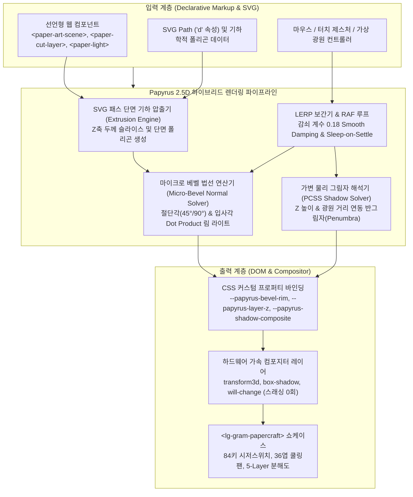

# Papyrus 2.5D Engine & LG Gram Papercraft System 기술 명세서

> **버전**: v1.0.0 (2026-10-17)  
> **상태**: Production Ready  
> **의존성**: 0-Dependency (순수 Vanilla JavaScript, CSS Custom Properties, SVG Path, Web Components v1)

---

## 1. 아키텍처 개요 (Architecture Overview)

**Papyrus**는 웹 표준 기술만을 사용하여 CSS의 2D 평면 박스 모델 한계를 극복하고, 실제 종이를 정밀 아트 나이프로 오려냈을 때 발생하는 **칼선 단면 두께(Extruded Edge)**, **마이크로 베벨 림 하이라이트(Micro-Bevel Normal Highlight)**, 그리고 **깊이 연동 물리 그림자(PCSS Depth-Variable Shadow)**를 실시간 렌더링하는 경량 2.5D 페이퍼 아트 엔진입니다.

Three.js, Babylon.js 등 수 MB에 달하는 무거운 3D 라이브러리 없이, 번들 크기 30KB 미만으로 60fps(프레임 타임 < 16.6ms) 하이브리드 파이프라인을 지원합니다.



---

## 2. 2.5D 렌더링 파이프라인 세부 원리

### 2.1 칼선 단면 두께 압출 (Extruded Edge Slicing)
- **원리**: 2D SVG 패스 데이터를 파싱하여 기하학적 정점 배열을 추출하고, 종이의 두께(기본 0.88px ~ 1.2px)만큼 Z축으로 슬라이스 오프셋된 단면 메쉬를 생성합니다.
- **수식**:
  $$\vec{V}_{extruded} = \vec{V}_{base} + (0, 0, Z_{elevation} + T_{thickness})$$
- 평면 일러스트에 실체적인 입체 두께감을 부여합니다.

### 2.2 마이크로 베벨 법선 하이라이트 (Micro-Bevel Normal Specular Rim)
- **원리**: 실제 종이를 칼로 45° 각도로 자르면 칼날이 지나간 절단면에 미세한 경사면(Bevel Slope)이 형성됩니다. 광원의 입사 벡터와 베벨 법선 벡터 사이의 내적(Dot Product)을 실시간 산출하여, 빛이 스칠 때 흰색 종이 엣지가 반짝이는 물리 림 라이트를 재현합니다.
- **수식**:
  $$\text{Specular} = \max\left(0, \cos\left(\theta_{incident} - \frac{\theta_{bevel}}{2}\right)\right) \cdot \sin(\theta_{bevel}) \cdot I_{light}$$
- 생성된 스펙큘러 값은 `--papyrus-bevel-rim: rgba(255, 255, 255, \alpha)` 및 `--papyrus-bevel-specular`로 주입되어 나이프 엣지에 즉각 반영됩니다.

### 2.3 PCSS 가변 반그림자 해석기 (Percentage Closer Soft Shadows)
- **원리**: 종이 레이어가 바닥에서 멀어질수록 그림자의 반그림자(Penumbra) 영역이 넓어지며 흐려집니다. 광원까지의 거리와 레이어 높이($Z$)에 비례하여 블러($\text{blur}$)와 오프셋($dx, dy$)을 연산합니다.
- **2-Tier 물리 그림자 구조**:
  1. **접촉 그림자(Contact Shadow)**: 종이가 닿는 곳의 짙고 또렷한 앰비언트 오클루전 그림자 ($0.4 \times Z$ blur).
  2. **확산 그림자(Diffuse Shadow)**: 공중에 뜬 종이가 만들어내는 부드러운 가변 반그림자 ($1.6 \times Z + 2.5$ blur).
- 색상은 수제 종이의 깊이감을 표현하는 번트 엄버(Burnt Umber, `rgba(46, 30, 20, \alpha)`) 계조를 사용합니다.

### 2.4 Sleep-on-Settle 및 프레임 버짓 보장 (60fps)
- 마우스나 가상 광원이 정지하여 LERP 목표 좌표와 현재 좌표의 오차가 $0.05\text{px}$ 미만으로 수렴하면 즉시 `cancelAnimationFrame`을 호출하여 **CPU 점유율을 0%로 회수(Sleep-on-Settle)**합니다.
- 레이아웃 스래싱을 방지하기 위해 DOM 읽기와 쓰기(`style.setProperty`, `transform3d`)를 분리하여 단일 프레임 연산 시간이 **16.6ms 미만**으로 유지됩니다.

---

## 3. 웹 컴포넌트 API 명세 (Web Components API)

### 3.1 `<paper-art-scene>`
3D 시야각(Perspective) 뷰포트와 포인터 트래킹, 광원 오케스트레이션을 총괄하는 최상위 컨테이너 컴포넌트입니다.

#### 속성 (Attributes & Properties)
| 속성명 | 타입 | 기본값 | 설명 |
| :--- | :--- | :--- | :--- |
| `perspective` | string | `'1200px'` | 3D 공간 투영 거리 |
| `view-mode` | string | `'perspective'` | 뷰 모드 (`'perspective'` \| `'orthographic'`) |
| `exploded` | boolean | `false` | 분해도 모드 활성화 여부 |
| `exploded-gap` | number | `40` | 분해도 모드 시 레이어 간 Z축 간격 (px) |
| `track-pointer` | boolean | `true` | 마우스/터치 위치에 따른 실시간 시점 및 광원 추적 |
| `light-smoothing`| number | `0.18` | LERP 감쇠 보간 계수 (0.01 ~ 1.0) |
| `light-x` | number | `150` | 주 광원 X 좌표 (px) |
| `light-y` | number | `-150` | 주 광원 Y 좌표 (px) |
| `light-z` | number | `250` | 주 광원 Z 높이 (px) |

#### 공개 메서드
- `setLightCoordinates(x, y, z)`: 주 광원의 공간 좌표를 변경합니다.
- `updateScene()`: 하위 레이어와 광원의 상태를 즉시 재계산하고 동기화합니다.
- `requestSceneUpdate()`: RAF 기반으로 다음 렌더링 틱에 씬 업데이트를 예약합니다.

---

### 3.2 `<paper-cut-layer>`
단일 종이 절단 레이어의 2.5D 두께, 칼선 각도, 재질, 물리 그림자를 담당하는 자식 컴포넌트입니다.

#### 속성 (Attributes & Properties)
| 속성명 | 타입 | 기본값 | 설명 |
| :--- | :--- | :--- | :--- |
| `depth` | number | `0` | 기본 표면 기준 Z축 높이 (px) |
| `thickness` | string | `'1.2px'` | 종이 원지의 절단면 단면 두께 |
| `cut-angle` | number | `45` | 나이프 칼선 절단 각도 (도, e.g. 45°, 90°) |
| `material` | string | `'white-craft'`| 종이 질감 재질 토큰 |
| `bevel` | boolean | `true` | 마이크로 베벨 림 하이라이트 활성화 여부 |
| `cast-shadow` | boolean | `true` | PCSS 물리 그림자 투영 여부 |
| `elevation-factor` | number | `1.0` | 분해도 전개 시 가중 승수 |

---

### 3.3 `<paper-light>`
선언적으로 광원을 정의하며, 씬 내부에서 다중 광원을 관리할 수 있는 컴포넌트입니다.

#### 속성 (Attributes & Properties)
| 속성명 | 타입 | 기본값 | 설명 |
| :--- | :--- | :--- | :--- |
| `type` | string | `'point'` | 광원 타입 (`'point'` \| `'directional'`) |
| `x`, `y`, `z` | number | `150, -150, 250` | 광원 3D 위치 좌표 |
| `intensity` | number | `1.0` | 광원 밝기 세기 (0.0 ~ 2.0) |
| `color` | string | `'#ffffff'` | 광원 색상 HEX 코드 |
| `cast-shadow` | boolean | `true` | 그림자 생성 여부 |
| `track-pointer` | boolean | `false` | 마우스 포인터와 좌표 자동 연동 |

---

### 3.4 `<lg-gram-papercraft>`
2016년 송훈 페이퍼크래프트 작가의 순백 테크 미학을 계승하여 LG 그램 15인치 노트북을 5개 정밀 레이어로 구현한 테크 페이퍼크래프트 쇼케이스 컴포넌트입니다.

#### 구조 레이어 (5 Core Layers)
1. **L1 하판 섀시 베이스 (Chassis Base)**: 48개 레이저 쿨링 슬릿, 4개 모서리 고무 받침, 미세 챔퍼 베벨 테두리.
2. **L2 메인보드 및 듀얼 쿨링팬 (Motherboard & Fans)**: 0.1mm 정밀 36엽 마이크로 터보 블레이드 2조, 구리 히트파이프 및 칩셋 인레이.
3. **L3 배터리 팩 및 터치패드 (Battery & Trackpad)**: 80Wh 고밀도 배터리 셀 팩, 하부 터치패드 서브마운트.
4. **L4 키보드 C커버 덱 (Keyboard Deck)**: 84키 시저스위치 매트릭스, 1.2mm 스트로크 햅틱 눌림 인터랙션.
5. **L5 디스플레이 A커버 상판 (Display Lid & Hinge)**: gram 음각 로고, 180도 정밀 접합 힌지 (0°~135° 개폐).

#### 공개 메서드
- `setExploded(isExploded: boolean, gap?: number)`: 분해도 모드를 켜거나 끄고 레이어 간격을 조절합니다.
- `setHingeAngle(angleDeg: number)`: 디스플레이 상판의 개폐 각도를 0°~135° 범위로 조절합니다.
- `setFanSpeed(rpm: number)`: 36엽 듀얼 쿨링팬의 회전 속도(0 ~ 5000 RPM)를 조절합니다.
- `triggerKey(keyCodeOrChar: string)`: 84키 중 해당 키캡을 1.2mm 물리 스트로크로 누르는 애니메이션을 구동합니다.
- `updateLighting(lightData: object)`: 상위 엔진으로부터 광원 데이터를 전달받아 엣지 림을 갱신합니다.

---

## 4. 실전 코드 예제 (Usage Examples)

### 4.1 HTML 선언형 마크업 조립
```html
<!-- Papyrus 2.5D 장면 구성 -->
<paper-art-scene perspective="1300px" track-pointer="true">
  <!-- 가상 포인트 광원 -->
  <paper-light type="point" x="180" y="-120" z="280" intensity="1.2" color="#ffffff"></paper-light>

  <!-- 독립 2.5D 종이 레이어 조립 -->
  <paper-cut-layer depth="10" thickness="1.2px" cut-angle="45" material="white-craft">
    <div class="custom-paper-card">베이스 종이 카드</div>
  </paper-cut-layer>

  <paper-cut-layer depth="35" thickness="1.5px" cut-angle="45">
    <div class="custom-paper-emboss">상단 부유 레이어</div>
  </paper-cut-layer>
</paper-art-scene>
```

### 4.2 LG 그램 페이퍼크래프트 자바스크립트 제어
```javascript
import './src/engine/papyrus-engine.js';
import './src/components/paper-art-scene.js';
import './src/components/lg-gram-papercraft.js';

const gram = document.querySelector('lg-gram-papercraft');

// 1. 분해도 모드 활성화 (Z축 간격 60px)
gram.setExploded(true, 60);

// 2. 노트북 힌지 각도를 110도로 설정
gram.setHingeAngle(110);

// 3. 쿨링팬 속도를 3,600 RPM으로 증속
gram.setFanSpeed(3600);

// 4. 'G' 키캡 타건 햅틱 트리거
gram.triggerKey('KeyG');
```

---

## 5. 접근성 및 성능 기준 (Accessibility & Performance)

1. **WCAG 2.1 AA 및 키보드 내비게이션**:
   - `<paper-art-scene>`은 `role="region"`, `aria-label`, `tabindex="0"`을 갖추어 스크린 리더와 키보드 초점 이동을 지원합니다.
   - 방향키(Arrow Up/Down/Left/Right), Page Up/Down 키로 시점과 가상 광원을 접근성 친화적으로 회전할 수 있습니다.
2. **모션 감소 대응 (`prefers-reduced-motion: reduce`)**:
   - 시스템의 모션 감소 옵션 활성화 시 모든 CSS 트랜지션과 팬 회전 애니메이션이 즉각 중지되며, 렌더링 루프는 정적 슬립 모드로 진입합니다.
3. **Flaticon UIcons (`fi fi-rr-*`) 단일 아이콘 표준**:
   - UI 상의 모든 제어 버튼과 정보 뱃지는 Flaticon Regular Rounded 스타일 아이콘을 사용하여 일관된 그래픽 완성도를 보장합니다.
4. **한국어 타이포그래피 표준**:
   - 어절 단위 줄바꿈(`break-keep`), 제목 균형 배치(`text-balance`), 본문 외톨이 단어 방지(`text-pretty`)를 철저히 적용하여 가독성을 극대화합니다.
